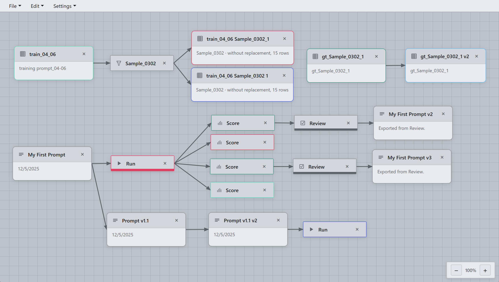

<div align="center">

# Prompt Studio

**Prompt engineering with you in the loop. Every iteration traceable.**

Desktop app for **prompt engineering** and **evaluation**: design prompts, run on datasets, score against ground truth, refine with AI. Human in the loop, every iteration traceable.



[Getting Started](#quick-start) · [Features](#features) · [How to use](#how-to-use) · [API](#api)

</div>

---

## Features

| Feature | Description |
|--------|-------------|
| **Prompt nodes** | Multi-section prompts with placeholders and structured output schemas |
| **Dataset nodes** | Import CSV/Excel or sample from larger datasets |
| **Run nodes** | Execute prompts row-by-row with OpenAI, Anthropic, Google, DeepSeek, Mistral, Bedrock |
| **Score nodes** | Compare outputs with ground truth using flexible matching rules |
| **Review nodes** | LLM analyzes results and suggests prompt improvements |
| **Resume** | Continue interrupted runs from checkpoint |
| **Cancel** | Stop running jobs anytime from the UI |

## Quick Start

**Prerequisites:** Node.js 16+, Python 3.10+, and API keys for your LLM providers.

```bash
# 1. Backend
cd backend
python -m venv .venv
.venv\Scripts\activate          # Windows
# source .venv/bin/activate     # macOS/Linux
pip install -r requirements.txt

# 2. Frontend
cd ../app
npm install
npm start
```

The app launches with the workflow UI. Credentials and settings live in `backend/data/`.

## How to use

Prompt Studio follows a **Design → Run → Score → Review** workflow. You build a graph of nodes on the canvas, connect them, and iterate.

### 1. Add a Dataset

Create a Dataset node and import your evaluation data (CSV or Excel). Typical columns: `question`, `answer` (ground truth), `context`, or any fields your prompts need. This dataset is your source of test cases.

### 2. (Optional) Add a Sampler

If your dataset is large, add a Sampler node to take a subset (e.g. 20 rows) for quick iteration. Connect it to your Dataset. You can run prompts on the sample first, then scale to the full dataset later.

### 3. Add a Prompt

Create a Prompt node. Write your prompt in structured sections (System, User, Context). Use `{placeholders}` for inputs—e.g. `{question}` and `{context}`. Map these to dataset columns when you run. You can define an output schema (e.g. `answer: string`) for structured responses.

### 4. Run

Add a Run node. Connect it to your Prompt and Dataset. Map dataset columns to prompt placeholders, choose an LLM (OpenAI, Anthropic, etc.), and click Run. The app executes your prompt row-by-row and shows results in a table. If interrupted, you can Resume from the last checkpoint.

### 5. Score

Add a Score node. Connect it to a ground-truth Dataset. Map output fields (e.g. `answer`) to ground-truth columns and choose match rules (exact, contains, numeric). The Score view shows match/mismatch for each row.

### 6. Review

Add a Review node. The LLM analyzes mismatches and suggests concrete prompt edits. Accept or reject each suggestion. You can also chat with the Review assistant to ask follow-up questions. Accepted changes update your Prompt; then you Run and Score again to validate.

### Tips

- **Version your prompts**: Each Prompt node tracks changes. Compare different versions by running them on the same dataset.
- **Branch freely**: You can run the same prompt on multiple datasets, or try multiple refinements on separate branches. The canvas supports flexible graphs.
- **API keys**: Add credentials in Settings (or `backend/data/credentials.json`) for the providers you use.

## Build

```bash
cd app
npm run dist
```

Output: Windows executable in `out/`. Backend is bundled with an embedded Python runtime.

## Project Structure

```
├── app/                 # Electron frontend
│   ├── src/
│   │   ├── workflowCanvas.js
│   │   ├── runDetailModal.js
│   │   ├── promptDetailModal.js
│   │   └── ...
│   └── package.json
├── backend/             # Python API
│   ├── main.py          # FastAPI, run/review logic
│   ├── llm.py           # LangChain integration
│   └── data/            # credentials, settings
├── images/              # Screenshots, provider logos
└── website/             # Landing page
```

## API

REST API on `http://127.0.0.1:8000`:

| Method | Endpoint | Description |
|--------|----------|-------------|
| GET | `/health` | Health check |
| GET/POST | `/api/credentials` | Manage API keys |
| GET/PATCH | `/api/settings` | App settings |
| POST | `/api/run` | Start run (202 + `run_id`) |
| GET | `/api/run/result/{run_id}` | Poll status & results |
| POST | `/api/run/cancel/{run_id}` | Cancel run |
| POST | `/api/review/*` | Prompt review |
